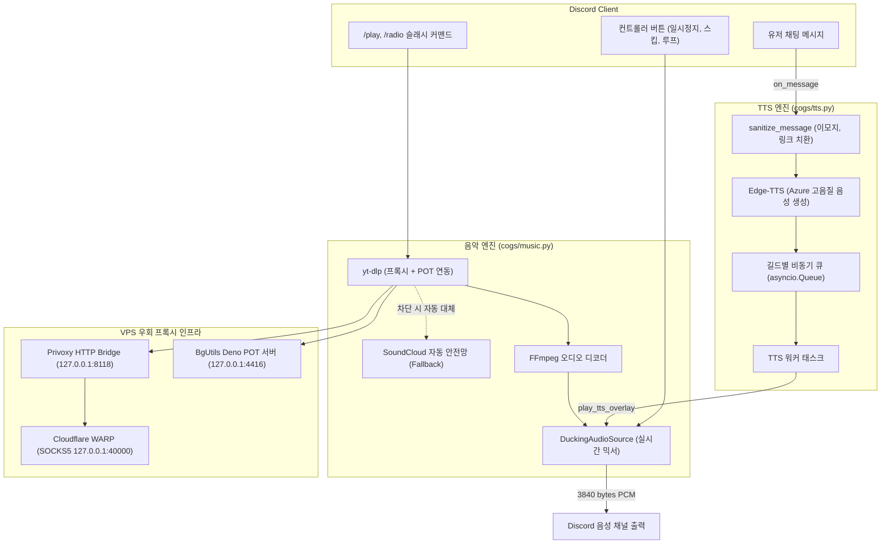

# 🎧 Discord Music & TTS Bot 마스터 아키텍처 및 복제/이식 가이드

이 문서는 본 프로젝트의 **모든 기능(유튜브 봇 차단 우회, 초반 배속 방지 패치, Ducking/Pause 오디오 믹서, 스마트 TTS 채널 바인딩, 24시간 무중단 라디오, 메시지 폭탄 방지 In-Place Edit, 멘션 알림 제거)**을 다른 디스코드 봇 프로젝트에 100% 동일하게 이식하거나 복제할 수 있도록 정리한 완성형 매뉴얼입니다.

---

## 📑 목차
1. [전체 프로젝트 디렉토리 구조](#1-전체-프로젝트-디렉토리-구조)
2. [시스템 아키텍처 흐름도](#2-시스템-아키텍처-흐름도)
3. [유튜브 봇 차단(403/Sign-in) 우회 인프라 3종 세트](#3-유튜브-봇-차단403sign-in-우회-인프라-3종-세트)
4. [discord.py 오디오 초반 배속/빨리감기(Burst) 방지 패치](#4-discordpy-오디오-초반-배속빨리감기burst-방지-패치)
5. [DuckingAudioSource: 실시간 덕킹 & 일시정지 믹서](#5-duckingaudiosource-실시간-덕킹--일시정지-믹서)
6. [Discord Intents & 스마트 채팅-음성 채널 라우팅](#6-discord-intents--스마트-채팅-음성-채널-라우팅)
7. [24시간 라디오 & 메시지 누적 방지(In-Place Edit)](#7-24시간-라디오--메시지-누적-방지in-place-edit)
8. [신청자 멘션(@) 제거 및 깔끔한 UI 임베드](#8-신청자-멘션-제거-및-깔끔한-ui-임베드)
9. [나만의 라디오 플레이리스트로 교체하는 방법 (Step-by-Step)](#9-나만의-라디오-플레이리스트로-교체하는-방법-step-by-step)
10. [VPS에 다중 봇(2호기)으로 배포 및 24시간 가동 가이드](#10-vps에-다중-봇2호기로-배포-및-24시간-가동-가이드)

---

## 1. 전체 프로젝트 디렉토리 구조

```text
discord-music-tts-template/
├── .env.example                # 디스코드 토큰 및 환경변수 템플릿
├── config.json                 # 봇 기본 접두사 및 테마 컬러 설정
├── requirements.txt            # 필수 파이썬 라이브러리 목록
├── run.bat                     # 윈도우 로컬 실행용 배치 스크립트
├── build_custom_radio_db.py    # 유튜브 플레이리스트 -> 라디오 DB 자동 수집기
├── main.py                     # 봇 초기화, 인텐트 설정, Cog 동적 로드
├── cogs/
│   ├── music.py                # 음악 재생, FFmpeg 제어, 라디오 루프, 컨트롤러 UI
│   └── tts.py                  # Edge-TTS 음성 생성, 스마트 세션 바인딩, 덕킹 연동
└── data/
    ├── custom_radio_database.json # 라디오용 음원 메타데이터 (빌드 후 생성)
    ├── music_settings.json     # 길드별 자동퇴장 등 음악 설정 저장
    ├── playlists.json          # 유저별 개인 커스텀 플레이리스트
    ├── tts_settings.json       # 길드/유저별 목소리, 속도, 덕킹 모드 저장
    └── tts_cache/              # 변환된 임시 TTS MP3 저장소 (자동 정리)
```

---

## 2. 시스템 아키텍처 흐름도



---

## 3. 유튜브 봇 차단(403/Sign-in) 우회 인프라 3종 세트

### 원인
클라우드 서버(AWS, Vultr, Oracle 등) IP는 유튜브 Botguard에 의해 블랙리스트 등록되어, `Sign in to confirm you're not a bot` 또는 오디오 스트림 403 Forbidden 오류가 발생합니다.

### 3단 해결 인프라 구성
1. **Cloudflare WARP (SOCKS5 - 로컬 포트 `40000`)**
   - 데이터센터 IP 대신 Cloudflare Anycast 주거/클라우드 대역으로 IP를 마스킹.
   ```bash
   warp-cli mode proxy
   warp-cli proxy port 40000
   warp-cli connect
   ```
2. **Privoxy HTTP 브릿지 (HTTP - 로컬 포트 `8118`)**
   - yt-dlp와 FFmpeg가 SOCKS5 프록시에서 겪는 DNS 누출/핸드셰이크 문제를 해결하기 위해 SOCKS5를 HTTP 프록시로 변환.
   - `/etc/privoxy/config`:
     ```text
     listen-address 127.0.0.1:8118
     forward-socks5 / 127.0.0.1:40000 .
     ```
3. **BgUtils PO Token Provider v2 (Deno HTTP - 로컬 포트 `4416`)**
   - 유튜브 Botguard WebAssembly 챌린지를 Deno 가상 런타임에서 연산하여 실시간 Visitor Data 및 PO Token을 발급.

### 코드 반영 (`cogs/music.py`)
```python
# 1. yt-dlp 옵션
YTDL_YT_OPTIONS = {
    "format": "bestaudio[abr>0]/bestaudio/best",
    "extractaudio": True,
    "audioformat": "mp3",
    "noplaylist": True,
    "proxy": "http://127.0.0.1:8118" if is_port_open(8118) else None,
    "extractor_args": {
        "youtubepot-bgutilhttp": {
            "base_url": ["http://127.0.0.1:4416"]
        }
    } if is_port_open(4416) else {},
    "cookiefile": "cookies.txt" if Path("cookies.txt").exists() else None,
    "remote_components": ["ejs:github"],
}

# 2. FFmpeg 옵션: 유튜브 스트림 CDN은 반드시 추출 IP와 동일한 IP로 스트리밍해야 403이 안 남
FFMPEG_YT_OPTIONS = {
    "before_options": "-http_proxy http://127.0.0.1:8118 -reconnect 1 -reconnect_streamed 1 -reconnect_delay_max 5"
                      if is_port_open(8118) else "-reconnect 1 -reconnect_streamed 1 -reconnect_delay_max 5",
    "options": "-vn -nostdin",
}
```

---

## 4. discord.py 오디오 초반 배속/빨리감기(Burst) 방지 패치

### 원인
`discord.py` 기본 오디오 전송기는 곡이 시작될 때 첫 패킷을 읽기 전에 타이머(`_start = time.perf_counter()`)를 켭니다. FFmpeg가 네트워크 스트림을 파싱하는 초기 1초 동안 시간이 흘러 루프가 "시간이 밀렸다"고 판단해 수십 개의 패킷을 Discord로 폭주 전송(Burst)하여 초반 1~2초가 2~3배속으로 재생되는 문제가 생깁니다.

### 해결책: 몽키패치 (`cogs/music.py` 최상단)
```python
def _patch_discord_audio_player():
    if getattr(discord.player.AudioPlayer, "_music_bot_patched", False):
        return

    orig_do_run = discord.player.AudioPlayer._do_run

    def patched_do_run(self):
        self.loops = 0
        self._start = None  # 첫 패킷이 실제로 디코딩된 시점에 타이머 시작!

        client = self.client
        play_audio = client.send_audio_packet
        self._speak(discord.player.SpeakingState.voice)

        while not self._end.is_set():
            if not self._resumed.is_set():
                self.send_silence()
                self._resumed.wait()
                continue

            data = self.source.read()
            if not data:
                self.stop()
                break

            if not client.is_connected():
                connected = client.wait_until_connected(client.timeout)
                if self._end.is_set() or not connected:
                    return
                self._speak(discord.player.SpeakingState.voice)
                self.loops = 0
                self._start = None

            now = time.perf_counter()
            if self._start is None:
                self._start = now

            play_audio(data, encode=not self.source.is_opus())
            self.loops += 1
            next_time = self._start + self.DELAY * self.loops
            diff = next_time - now

            # 네트워크 지연으로 뒤처질 경우 버스트 전송 방지 및 타이머 리셋
            if diff < -0.06:
                self._start = now
                self.loops = 0
                next_time = self._start + self.DELAY
                diff = 0

            delay = max(0, self.DELAY + diff)
            time.sleep(delay)

        if client.is_connected():
            self.send_silence()

    discord.player.AudioPlayer._do_run = patched_do_run
    discord.player.AudioPlayer._music_bot_patched = True

_patch_discord_audio_player()
```

---

## 5. DuckingAudioSource: 실시간 덕킹 & 일시정지 믹서

### 원인 & 요구사항
- 디스코드 `VoiceClient`는 한 번에 하나의 스트림만 재생할 수 있습니다.
- 음악이 나오는 도중 유저가 채팅을 치면:
  - **덕킹(duck) 모드**: 음악 소리를 20%로 줄이고 TTS 음성을 위에 얹어서 동시 출력.
  - **일시정지(pause) 모드**: 음악 스트림 읽기를 멈추고 TTS 음성만 단독 출력한 뒤 완료 즉시 음악 재개.
- discord.py 2.0+ 버전에서는 오디오 스레드 내에서 `bot.loop` 프로퍼티에 접근하면 `AttributeError: loop attribute cannot be accessed in non-async contexts`를 던집니다.

### 핵심 구현 코드
```python
class DuckingAudioSource(discord.AudioSource):
    def __init__(self, music_source: discord.AudioSource, player, loop=None):
        self.music_source = music_source
        self.player = player
        self.loop = loop or asyncio.get_event_loop()
        self.current_tts_source = None
        self.tts_done_event = None
        self.tts_mode = "duck"  # "duck" | "pause"
        self.duck_volume_ratio = 0.2
        self._lock = threading.Lock()

    def set_tts(self, tts_source, done_event, mode="duck", duck_ratio=0.2, loop=None):
        with self._lock:
            if self.current_tts_source:
                try: self.current_tts_source.cleanup()
                except Exception: pass
            self.current_tts_source = tts_source
            self.tts_done_event = done_event
            self.tts_mode = mode
            self.duck_volume_ratio = max(0.0, min(1.0, duck_ratio))
            if loop:
                self.loop = loop

    def _finish_tts(self):
        with self._lock:
            had_tts = bool(self.current_tts_source or self.tts_done_event)
            if self.current_tts_source:
                try: self.current_tts_source.cleanup()
                except Exception: pass
                self.current_tts_source = None
            if self.tts_done_event:
                target_loop = getattr(self, "loop", None)
                if target_loop and not target_loop.is_closed():
                    try: target_loop.call_soon_threadsafe(self.tts_done_event.set)
                    except Exception: self.tts_done_event.set()
                else:
                    self.tts_done_event.set()
                self.tts_done_event = None
            if had_tts:
                print("[DuckingAudioSource] TTS completed, music resumed.")

    def read(self) -> bytes:
        with self._lock:
            tts_source = self.current_tts_source
            tts_mode = self.tts_mode

        # 1. TTS가 없을 때: 일반 음악 스트림
        if tts_source is None:
            music_data = self.music_source.read()
            if not music_data: return b""
            if self.player.volume != 1.0:
                music_data = audioop.mul(music_data, 2, self.player.volume)
            return music_data

        # 2. Pause 모드: TTS만 읽고 음악은 읽지 않음 (FFmpeg 내부 버퍼 보존)
        if tts_mode == "pause":
            tts_data = tts_source.read()
            if not tts_data:
                self._finish_tts()
                return self.music_source.read()
            if len(tts_data) < 3840: tts_data = tts_data.ljust(3840, b"\x00")
            elif len(tts_data) > 3840: tts_data = tts_data[:3840]
            return tts_data

        # 3. Duck 모드: 음악 감쇠 + TTS 오버레이 합성
        music_data = self.music_source.read()
        tts_data = tts_source.read()

        if not tts_data:
            self._finish_tts()
            return music_data

        effective_vol = max(0.0, self.player.volume * self.duck_volume_ratio)
        ducked_music = audioop.mul(music_data, 2, effective_vol)

        target_len = max(len(ducked_music), len(tts_data))
        ducked_music = ducked_music.ljust(target_len, b"\x00")
        tts_data = tts_data.ljust(target_len, b"\x00")

        mixed = audioop.add(ducked_music, tts_data, 2)
        # Discord Opus 인코더 표준 길이 보정 (20ms = 3840 bytes)
        if len(mixed) < 3840: mixed = mixed.ljust(3840, b"\x00")
        elif len(mixed) > 3840: mixed = mixed[:3840]
        return mixed
```

---

## 6. Discord Intents & 스마트 채팅-음성 채널 라우팅

### 1. `main.py`의 필수 인텐트 설정
```python
intents = discord.Intents.default()
intents.guilds = True
intents.voice_states = True
intents.message_content = True  # 필수: 없으면 clean_content가 항상 빈 문자열("")이 됨
```

### 2. 스마트 채널 자동 바인딩 (`cogs/tts.py`)
유저가 봇이 있는 통화방 내장 채팅에 적든, 일반 텍스트 채널에 적든 알아서 인식:
```python
@commands.Cog.listener()
async def on_message(self, message: discord.Message):
    if message.author.bot or not message.guild:
        return

    vc = message.guild.voice_client
    if not vc or not vc.is_connected():
        return

    session = self.active_sessions.get(message.guild.id)
    is_user_in_same_vc = bool(message.author.voice and message.author.voice.channel == vc.channel)

    if session:
        is_bound = (message.channel.id == session.get("channel_id"))
        is_vc_text = bool(vc.channel and message.channel.id == vc.channel.id)
        if not is_bound and not is_vc_text:
            if is_user_in_same_vc:
                self.bind_session(message.guild.id, message.channel.id, vc.channel.id)
            else:
                return
    else:
        if is_user_in_same_vc:
            self.bind_session(message.guild.id, message.channel.id, vc.channel.id)
        else:
            return
```

---

## 7. 24시간 라디오 & 메시지 누적 방지(In-Place Edit)

### 1. 빈 채널 자동 퇴장 예외
라디오 모드이거나 `auto_leave`가 False인 경우 유저가 없어도 퇴장 타이머를 실행하지 않음:
```python
if player and (player.radio_mode or not player.auto_leave):
    return
```

### 2. In-Place Embed Edit (임베드 무한 수정)
라디오 모드에서는 곡이 바뀔 때마다 새 메시지를 보내지 않고 기존 "Now Playing" 카드를 `edit()`:
```python
if self.text_channel and self.loop_mode != "song":
    embed = create_now_playing_embed(song, self)
    view = MusicControlView(self)

    if self.radio_mode and self.now_playing_message:
        try:
            await self.now_playing_message.edit(embed=embed, view=view)
        except discord.NotFound:
            self.now_playing_message = await self.text_channel.send(embed=embed, view=view)
        except Exception:
            self.now_playing_message = await self.text_channel.send(embed=embed, view=view)
    else:
        if self.now_playing_message:
            try: await self.now_playing_message.edit(view=None)
            except Exception: pass
        self.now_playing_message = await self.text_channel.send(embed=embed, view=view)
```

---

## 8. 신청자 멘션(@) 제거 및 깔끔한 UI 임베드

### 해결책
- **라디오 모드**: 신청자 필드를 아예 임베드에서 제외.
- **일반 모드**: 유저에게 핑 알림이 가지 않도록 `song.requester.mention` 대신 `song.requester.display_name`만 표기.
```python
def create_now_playing_embed(song: Song, player=None) -> discord.Embed:
    is_radio = getattr(song, "is_radio", False) or (player and player.radio_mode)

    embed = discord.Embed(
        title="📻 24시간 라디오 On-Air 🎵" if is_radio else "🎵 지금 재생 중 (Now Playing)",
        description=f"### [{song.title}]({song.webpage_url})",
        color=getattr(song, "radio_theme_color", 0x27C7FE)
    )
    embed.add_field(name="길이", value=format_duration(song.duration), inline=True)

    if not is_radio:
        req_name = song.requester.display_name if getattr(song, "requester", None) else "알 수 없음"
        embed.add_field(name="신청자", value=req_name, inline=True)

    if song.thumbnail:
        embed.set_thumbnail(url=song.thumbnail)
    return embed
```

---

## 9. 나만의 라디오 플레이리스트로 교체하는 방법 (Step-by-Step)

### 1단계: `build_custom_radio_db.py`에 원하는 재생목록 등록
파일 상단의 `CATEGORIES`와 `TARGET_PLAYLISTS`를 원하는 내용으로 변경합니다:
```python
CATEGORIES = {
    "all": {"name": "🌟 전체 셔플 방송", "color": 0x5865F2},
    "kpop": {"name": "🎤 K-POP 명곡 모음", "color": 0xE91E63},
    "lofi": {"name": "☕ 카페 / 코딩 로파이", "color": 0x9B59B6},
}

TARGET_PLAYLISTS = [
    ("kpop", "https://www.youtube.com/playlist?list=PLxxxxxxxxxxxxxxx", "인기 K-POP 모음"),
    ("lofi", "https://www.youtube.com/playlist?list=PLyyyyyyyyyyyyyyy", "로파이 플레이리스트"),
]
```

### 2단계: 데이터베이스 수집 스크립트 실행
```bash
python build_custom_radio_db.py
```
- 실행이 끝나면 `data/custom_radio_database.json` 파일에 곡 정보들이 자동 저장됩니다.

### 3단계: `cogs/music.py`에서 DB 경로 및 선택지 연결
`cogs/music.py`에서 `STELLIVE_DB_PATH` 상수를 `custom_radio_database.json`으로 지정하고, 슬래시 커맨드 카테고리 선택지를 내가 정의한 카테고리로 매핑하면 완료됩니다.

---

## 10. VPS에 다중 봇(2호기)으로 배포 및 24시간 가동 가이드

기존 1호기 봇이 동작 중인 VPS에서 추가 리소스(메모리 60MB 미만)만으로 2호기를 띄우는 방법입니다.

### 1. 원격 서버에 복제 디렉토리 생성
```bash
mkdir -p /home/ubuntu/discord-custom-bot
# 로컬의 파일들을 scp로 업로드
scp -i ~/.ssh/id_rsa -r ./discord-music-tts-template/* ubuntu@<VPS_IP>:/home/ubuntu/discord-custom-bot/
```

### 2. 가상환경 및 .env 설정
```bash
cd /home/ubuntu/discord-custom-bot
python3 -m venv venv
./venv/bin/pip install -r requirements.txt
cp .env.example .env
nano .env  # 2호기 봇의 DISCORD_BOT_TOKEN 입력 및 ENABLE_MESSAGE_CONTENT=true 설정
```

### 3. systemd 서비스 등록 (`/etc/systemd/system/discord-custom-bot.service`)
```ini
[Unit]
Description=Discord Custom Music & TTS Bot (2nd Bot)
After=network.target warp-svc.service privoxy.service

[Service]
Type=simple
User=ubuntu
WorkingDirectory=/home/ubuntu/discord-custom-bot
ExecStart=/home/ubuntu/discord-custom-bot/venv/bin/python3 /home/ubuntu/discord-custom-bot/main.py
Restart=always
RestartSec=5
StandardOutput=journal
StandardError=journal
Environment=PYTHONUNBUFFERED=1

[Install]
WantedBy=multi-user.target
```

### 4. 서비스 시작 및 상시 가동
```bash
sudo systemctl daemon-reload
sudo systemctl enable discord-custom-bot
sudo systemctl start discord-custom-bot
sudo systemctl status discord-custom-bot
```

> **포트 공유 팁**: 이미 가동 중인 **WARP SOCKS5 (40000)**, **Privoxy HTTP 브릿지 (8118)**, **BgUtils POT 서버 (4416)**는 다중 봇이 100% 동일한 포트를 공유할 수 있으므로, 추가 프록시나 서비스를 설치할 필요 없이 즉시 우회 기능을 공유합니다.
